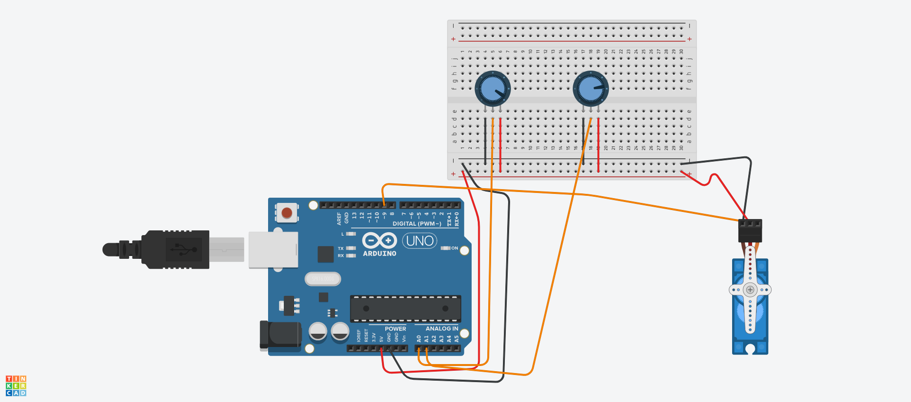
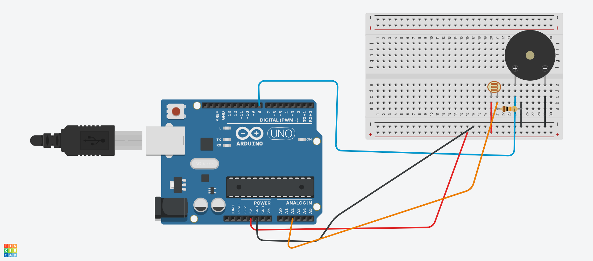

# Servo motor, potenciômetro, laser, LDR e piezo

**Curso:** Tecnologia em Análise e Desenvolvimento de Sistemas
**Unidade curricular:** Sistemas Embarcados
**Aluno(s):** Luis Felipe [coloque seu sobrenome e os outros nomes aqui]

## Explicação do projeto

Os dois projetos foram montados e simulados no Tinkercad, usando um Arduino Uno.

### Projeto 1: servo com dois potenciômetros

Um servo motor é controlado por dois potenciômetros.

- O potenciômetro 1 (pino A0) define o ângulo máximo de giro, de 0° a 180°.
- O potenciômetro 2 (pino A1) define a velocidade da hélice.

O servo fica indo e voltando entre 0° e o ângulo máximo escolhido. A velocidade é controlada pelo tempo de espera entre cada grau: quanto menor a espera, mais rápido ele gira.

| Componente | Ligação |
|---|---|
| Potenciômetro 1 | pontas no 5V e GND, pino do meio no A0 |
| Potenciômetro 2 | pontas no 5V e GND, pino do meio no A1 |
| Servo | fio vermelho no 5V, marrom no GND, laranja no pino 9 |

Código: [projeto1/projeto1.ino](projeto1/projeto1.ino)

### Projeto 2: detector de passagem de objeto

Um laser aponta para um LDR (sensor de luz). Enquanto o feixe chega no LDR, a leitura fica alta. Quando um objeto passa na frente, o LDR recebe menos luz, a leitura cai abaixo do limite e o piezo (buzzer) emite um sinal sonoro.

O LDR é ligado junto com um resistor de 10 kΩ (divisor de tensão), para o Arduino conseguir ler a quantidade de luz no pino A2.

| Componente | Ligação |
|---|---|
| LDR | uma perna no 5V, outra no A2 |
| Resistor 10 kΩ | entre a perna do LDR que vai no A2 e o GND |
| Piezo (+) | pino 8 |
| Piezo (−) | GND |
| Laser | pino 7 e GND (na montagem real) |

O Tinkercad não tem laser entre os componentes, então na simulação a queda de luz foi feita com o controle de luz do próprio LDR. O código já prevê o laser ligado no pino 7.

Para calibrar, olha-se no Monitor Serial o valor com luz alta e com luz baixa no LDR, e a variável `limite` fica no meio dos dois.

Código: [projeto2/projeto2.ino](projeto2/projeto2.ino)

## Componentes

Arduino Uno, servo motor, 2 potenciômetros, LDR, resistor de 10 kΩ, piezo (buzzer), laser (montagem real), protoboard e jumpers.

## Diagrama

### Projeto 1

### Projeto 2

